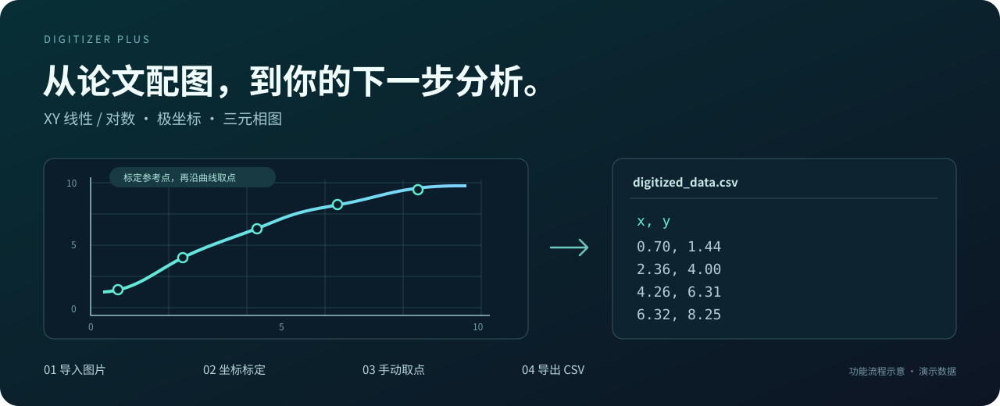

<div align="center">

# Digitizer Plus

### 把论文里的曲线，变成可分析的数据。

导入图表图片，标定坐标，沿曲线取点，导出 CSV。

**XY 线性 / 对数 · 极坐标 · 三元相图**

[](https://github.com/anyang1991/Digitizer_Plus/releases/latest)
[](https://github.com/anyang1991/Digitizer_Plus/releases/latest)
[](https://tauri.app/)
[](LICENSE)

**[下载安装包](https://github.com/anyang1991/Digitizer_Plus/releases/latest)** · [五步开始](#五步把图片变成数据) · [源码运行](#从源码运行) · [反馈问题](https://github.com/anyang1991/Digitizer_Plus/issues)



</div>

## 有图表，就能继续分析

论文里只有曲线图，没有附上数据表？Digitizer Plus 帮你从论文配图、扫描曲线和实验图像中提取坐标。完成标定后，沿曲线点击即可查看换算结果，再用 CSV 把数据带到 Excel、Python 或其他分析工具中。

| 你的图表 | 怎么标定 | 导出内容 |
| --- | --- | --- |
| XY 线性图、半对数图、双对数图 | X 轴 2 个已知刻度点 + Y 轴 2 个已知刻度点；每个轴单独选择线性或对数 | `x,y` |
| 极坐标图 | 圆心 O、已知半径 R、已知角度 θ | `theta,r` |
| 三元相图 | A、B、C 三个组元顶点 | `a,b,c`，组元占比之和为 100 |

## 围绕取数流程设计

- **常用图片直接导入**：支持点击选择或拖入图片，读取 PNG、JPEG、BMP、GIF、WebP 和 TIFF。
- **放大看清，再准确落点**：鼠标位置锚定缩放，配合画布平移查看细节。
- **三类坐标，一套操作流程**：XY、极坐标和三元相图都按「标定 → 取点 → 导出」完成。
- **边取点，边看数据**：右侧实时显示换算后的坐标，支持撤销最近的取点或标定操作。
- **CSV 接上你的分析流程**：按图表类型生成相应列名，方便继续绘图、拟合和数据对比。
- **本机处理图像**：图片解码与坐标换算在本机完成；应用可通过 GitHub 检查并安装签名更新。

当前取数流程以手动标定和点击取点为主。结果精度取决于原图分辨率、标定点和落点位置。

## 下载

前往 **[最新 Release](https://github.com/anyang1991/Digitizer_Plus/releases/latest)**，按你的设备选择安装包：

| 设备 | 选择文件 |
| --- | --- |
| Windows x64 | `Digitizer.Plus_<版本>_x64-setup.exe`；也提供 `.msi` |
| Mac · Apple Silicon | `Digitizer.Plus_<版本>_aarch64.dmg` |
| Mac · Intel | `Digitizer.Plus_<版本>_x64.dmg` |

`latest.json`、`.sig` 和 `.app.tar.gz` 用于应用更新；日常安装请选择上表中的文件。后续可使用应用内的「检查更新」。

## 五步把图片变成数据

1. **导入图片**：点击「导入图片」，或将图片拖入窗口。
2. **选择图表类型**：在顶栏选择 XY 图、极坐标图或三元相图。XY 图可单独设置 X / Y 轴的线性、对数刻度。
3. **标定已知坐标**：按左侧模式依次点击参考点，并输入它们的已知数值。
4. **沿曲线取点**：切换「取点」模式，逐个点击曲线；右侧数据表显示换算结果。
5. **导出 CSV**：保存数据表，在熟悉的分析工具中继续处理。

### 常用操作

| 操作 | 方法 |
| --- | --- |
| 缩放画布 | 鼠标滚轮，缩放围绕鼠标位置进行 |
| 平移画布 | Alt + 拖动，或按住鼠标中键 / 右键拖动 |
| 切换取点模式 | 点击工具栏「取点」，或使用界面显示的快捷键 `P` |
| 查看数值 | 右侧数据表随标定和取点更新 |

极坐标的角度以度为单位；三元相图导出 A、B、C 的百分比坐标。请在完成标定后导出，并检查刻度、方向和单位是否符合原图。

## 从源码运行

需要 Node.js 22.12+、npm、Rust，以及对应平台的 Tauri 构建依赖。项目锁定前端依赖后可直接使用 `npm ci`。

```bash
git clone https://github.com/anyang1991/Digitizer_Plus.git
cd Digitizer_Plus
npm ci
npm run tauri dev
```

构建安装包：

```bash
npm run tauri build
```

产物位于 `src-tauri/target/release/bundle/`。

### 代码结构

| 路径 | 内容 |
| --- | --- |
| `src/App.tsx` | 标定、取点、导出与模式切换 |
| `src/ImageCanvas.tsx` | 图像画布、缩放与平移 |
| `src/core.ts` | 前端坐标换算与 CSV 输出 |
| `src-tauri/src/calibration.rs` | Rust 标定与数值计算核心 |
| `src-tauri/src/lib.rs` | 本机文件导入、图片解码与 CSV 保存 |
| `scripts/` | XY、极坐标和三元相图的交互验证脚本 |

技术栈：**Tauri 2 + Rust + React 19 + TypeScript + Tailwind CSS 4**。

### 验证与发布

```bash
# Rust 核心单元测试
cd src-tauri
cargo test
```

仓库内提供端到端交互脚本；需先按脚本说明启动带调试端口的应用实例，再从项目根目录执行：

```bash
node scripts/e2e-chart-types.mjs
node scripts/e2e-polar-ring.mjs
node scripts/e2e-real-mouse-polar.mjs
```

维护者同步三处版本号并配置好更新签名 Secrets 后，可推送 `v*` 标签触发 `.github/workflows/release.yml`，生成 Windows 与两种 Mac 架构的发布资产。

## 反馈与贡献

欢迎提交 [Issue](https://github.com/anyang1991/Digitizer_Plus/issues) 或 PR。报告问题时附上操作系统、应用版本、图表类型和复现步骤；如果能分享一张有权公开的最小示例图，会更容易定位问题。

如果它帮你从论文图片中拿到了需要的数据，欢迎点个 **Star**，让更多做实验、读文献的人发现它。

## 致谢与许可

产品理念受 [Engauge Digitizer](https://github.com/markummitchell/engauge-digitizer) 启发，感谢 Mark Mitchell 与[社区维护者](https://github.com/akhuettel/engauge-digitizer)对开源图表数字化工具的贡献。Digitizer Plus 使用 Rust 与 TypeScript 独立实现标定、坐标换算和取数流程。

本项目采用 [MIT License](LICENSE)。

<details>
<summary>English overview</summary>

Digitizer Plus turns chart images into usable data. Import an image, calibrate known coordinates, click along a curve and export the sampled points as CSV.

It supports linear and logarithmic XY axes, polar coordinates and ternary diagrams. Image decoding and coordinate conversion run locally. Windows x64, Intel Mac and Apple Silicon installers are available in [Releases](https://github.com/anyang1991/Digitizer_Plus/releases/latest).

Built with Tauri 2, Rust, React and TypeScript. The current workflow uses manual calibration and point selection; accuracy depends on image quality and reference-point placement.

</details>
